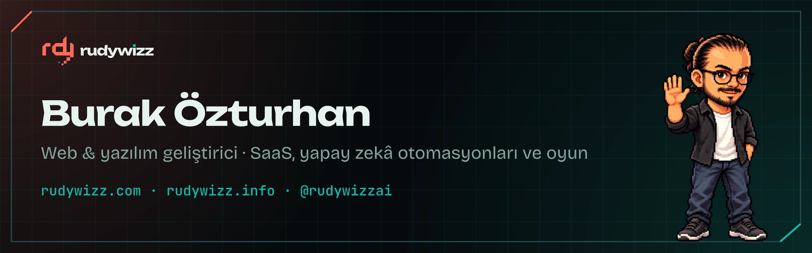
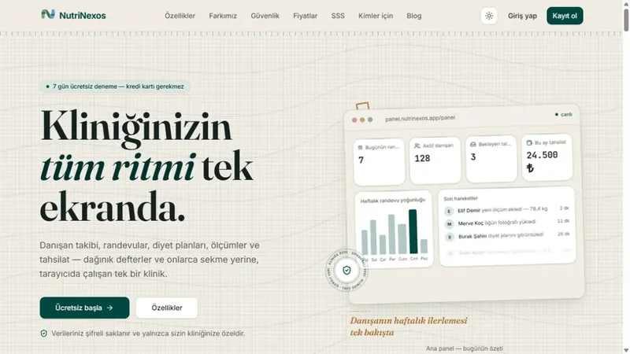
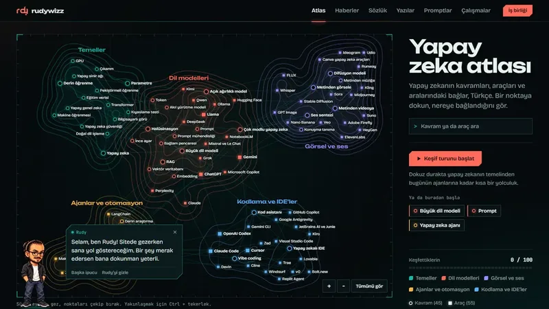
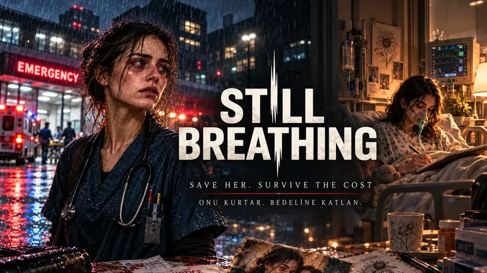
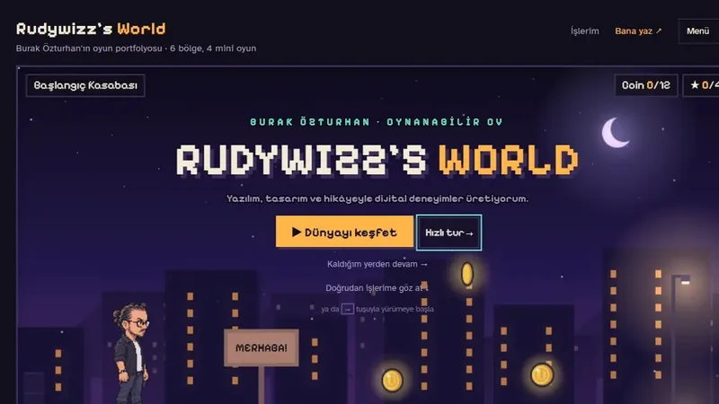
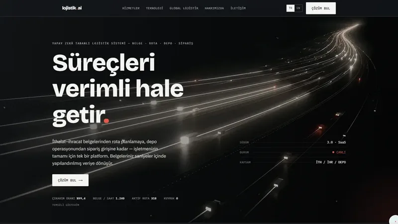
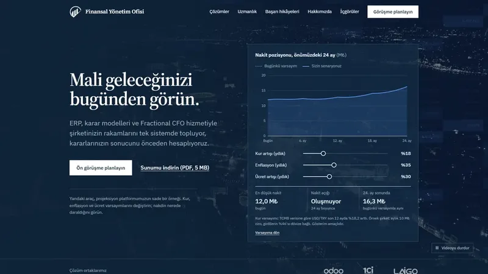
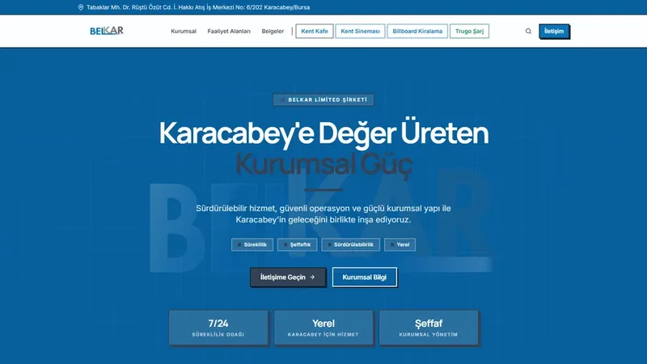
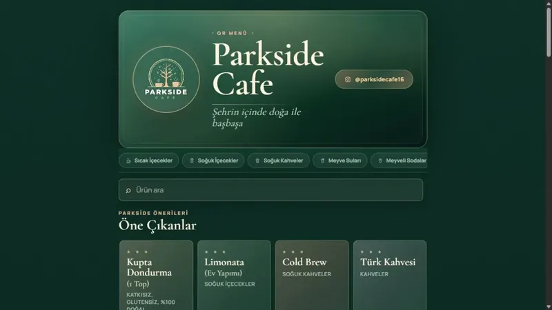

**Rudywizz** adıyla web uygulamaları, SaaS ürünleri, yapay zekâ otomasyonları ve oyunlar geliştiriyorum.
Bursa Karacabey'deyim; gündüz bilgi işlem uzmanıyım, kalan zamanımda kendi ürünlerimi ve freelance projeleri yürütüyorum.

- 🌐 [rudywizz.com](https://rudywizz.com): Türkçe yapay zekâ atlası ve sözlüğü
- 🎮 [rudywizz.info](https://rudywizz.info): oyun gibi oynanan portfolyom ve CV'm
- 📰 [@rudywizzai](https://www.instagram.com/rudywizzai/): her gün Türkçe yapay zekâ gündemi

## Projelerim

<table>
<tr>
<td width="50%" valign="top">

<h3><a href="https://nutrinexos.com">NutriNexos</a></h3>
Diyetisyenler için bulut tabanlı danışan ve klinik yönetim sistemi: randevu, ölçüm, beslenme planı tek ekranda. SaaS · Next.js · Supabase · Expo
</td>
<td width="50%" valign="top">

<h3><a href="https://rudywizz.com">rudywizz.com</a></h3>
Yapay zekâ kavramlarını ve araçlarını Türkçe anlatan etkileşimli atlas, sözlük ve her gün güncellenen haberler. Astro · etkileşimli harita · otomatik haber akışı
</td>
</tr>
<tr>
<td width="50%" valign="top">

<h3>Still Breathing</h3>
Acil servis hemşiresinin vardiyalarıyla hasta kardeşinin bakımını birleştiren, Türkçe anlatı odaklı PC oyunu. <i>Geliştiriliyor.</i> Godot 4 · C# · Ink
</td>
<td width="50%" valign="top">

<h3><a href="https://rudywizz.info">Rudywizz's World</a></h3>
Oyun gibi oynanan portfolyom ve CV'm: piksel karakterle 6 bölgeyi gezip projeleri keşfediyorsun. JavaScript · Canvas · piksel sanat
</td>
</tr>
<tr>
<td width="50%" valign="top">

<h3><a href="https://www.lojistik.ai">Lojistik.ai</a></h3>
Yapay zekâ destekli lojistik platformunun kurumsal tanıtım sitesi. TR/EN. Müşteri işi · Next.js
</td>
<td width="50%" valign="top">

<h3><a href="https://finansalyonetimofisi.com">Finansal Yönetim Ofisi</a></h3>
ERP ve Fractional CFO danışmanlığı için kurumsal site: etkileşimli nakit projeksiyonu ve finansal sağlık testi. Müşteri işi
</td>
</tr>
<tr>
<td width="50%" valign="top">

<h3><a href="https://belkarltd.com">Belkar</a></h3>
Karacabey'deki Belkar Ltd. için kurumsal site: Kent Kafe, sinema seansları ve online bilet satışı. Müşteri işi
</td>
<td width="50%" valign="top">

<h3><a href="https://parksideqrmenu.netlify.app/">Parkside Cafe QR menü</a></h3>
QR kodla açılan, baskı gerektirmeden güncellenen dijital menü. Müşteri işi · Astro
</td>
</tr>
</table>

**Yapay zekâ otomasyonları:** e-posta ve belge akışlarını okuyup iş sistemlerine işleyen, şirket içinde çalışan LLM boru hatları da kuruyorum.

## Kullandıklarım

- **Diller:** Python · TypeScript · JavaScript · C# · HTML/CSS
- **Web:** Next.js · Astro · React · FastAPI · Flask · Supabase · PostgreSQL
- **Oyun ve masaüstü:** Godot 4 · Unity · PyQt6
- **Yapay zekâ:** LLM entegrasyonu · ajanlarla geliştirme · kendi sunucusunda çalışan modeller
- **Video:** Premiere Pro · After Effects · DaVinci Resolve

## İletişim

Freelance projelere açığım. [iletisim@rudywizz.com](mailto:iletisim@rudywizz.com) · [LinkedIn](https://www.linkedin.com/in/burak-ozturhan-rudywizz)

> Çoğu çalışmam müşteri projesi olduğu için depoları gizli; ayrıntılar için yazabilirsin.
